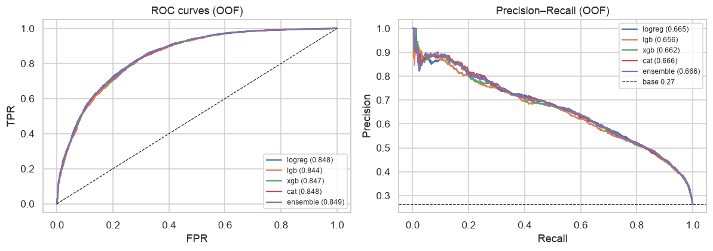
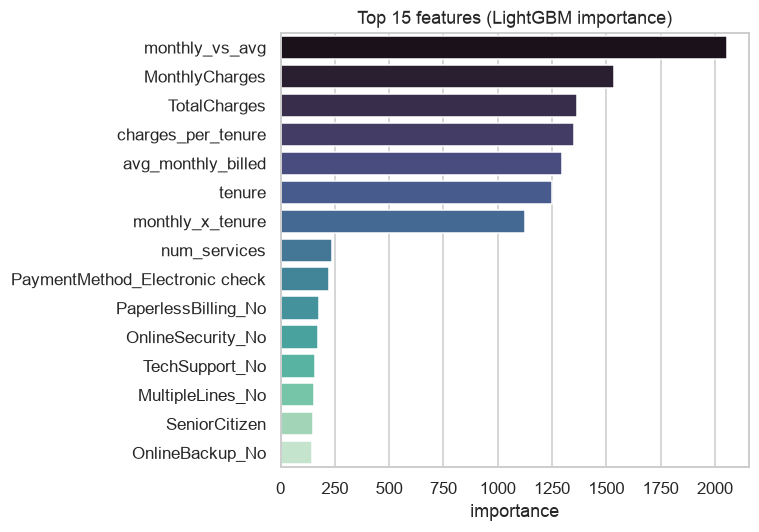

# Telco Customer Churn Prediction

Predicting customer churn from account, service, and billing attributes using the IBM Telco Customer Churn dataset. The best model, a soft-voting ensemble, reaches **ROC-AUC 0.849** under 5-fold × 3-seed cross-validation.

## Dataset

- IBM sample "Telco Customer Churn" ([Kaggle: blastchar/telco-customer-churn](https://www.kaggle.com/datasets/blastchar/telco-customer-churn))
- 7,043 customers × 21 columns; target `Churn` is 26.5% Yes (imbalanced)
- The raw data is not included in this repository. Download it from Kaggle and place the CSV in `data/`.

## Approach

1. **EDA** — churn distribution, churn by category and tenure, Cramér's V for categorical features, Mann–Whitney tests for numeric features
2. **Cleaning** — `TotalCharges` is stored as text with 11 blank values, all belonging to brand-new customers (tenure = 0); these were set to 0
3. **Feature engineering** — service counts, contract and payment flags, and billing-dynamics features such as `monthly_vs_avg` (current charge vs. historical average) and `charges_per_tenure`; one-hot encoding gives 55 numeric features
4. **Modeling** — logistic regression baseline, LightGBM, XGBoost, CatBoost, and a soft-voting ensemble, with class imbalance handled per model

## Results

| Model | ROC-AUC | PR-AUC | Best F1 |
|---|---|---|---|
| Logistic Regression | 0.848 | 0.665 | 0.637 |
| LightGBM | 0.844 | 0.656 | 0.629 |
| XGBoost | 0.847 | 0.662 | 0.631 |
| CatBoost | 0.848 | 0.666 | 0.633 |
| **Ensemble** | **0.849** | 0.666 | 0.635 |

All metrics are out-of-fold (StratifiedKFold, 5 folds × seeds 42, 2024, 7).

**Key findings**

- Contract type, tenure, and billing dynamics drive churn. Month-to-month contracts, fiber-optic internet, and electronic-check payment mark a high-churn segment, while add-on services and long tenure are protective.
- The engineered billing features (`monthly_vs_avg`, `charges_per_tenure`, `avg_monthly_billed`) rank among the most important features.
- Logistic regression is nearly tied with the ensemble, which suggests the churn signal is mostly linear in these features.




## Repository Structure

```
├── src/
│   ├── eda.py                 # Phase 1: exploratory analysis, figures
│   ├── pipeline.py            # Cleaning and feature engineering
│   ├── model.py               # Modeling, metrics, ROC/PR and importance figures
│   └── build_paper_html.py    # Converts paper.md to paper.html
└── reports/
    ├── report.md              # Study report
    ├── paper.md               # Formal write-up
    ├── phase1_eda.md          # EDA output
    ├── phase4_model.md        # Modeling output
    ├── metrics.json           # Cross-validated metrics
    └── figures/               # Plots
```

## How to Run

```bash
pip install pandas numpy scipy scikit-learn lightgbm xgboost catboost matplotlib
python src/eda.py      # EDA figures and phase1_eda.md
python src/model.py    # metrics.json, ROC/PR and importance figures
```

## Limitations

- ROC-AUC around 0.85 is typical for this dataset; the label is a single snapshot with no behavioral or temporal history.
- For retention decisions, PR-AUC and recall at a business-chosen threshold matter more than AUC; a cost-sensitive threshold should follow the retention economics.
- No time-based validation, so deployment performance may differ.