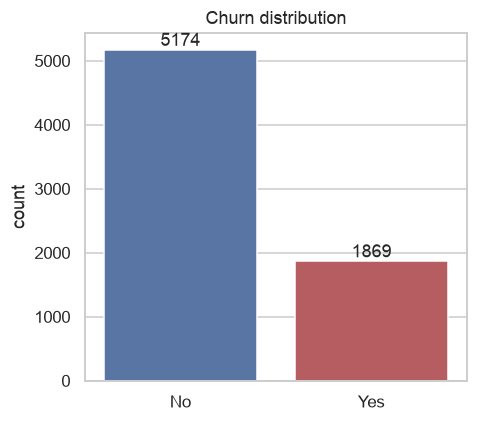
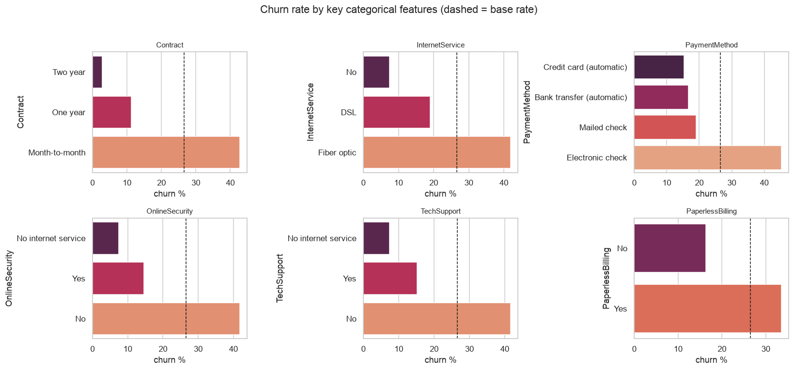
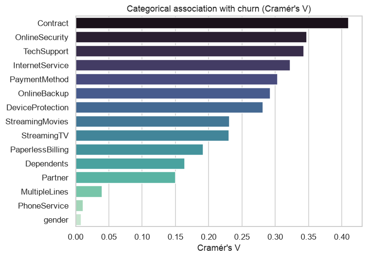
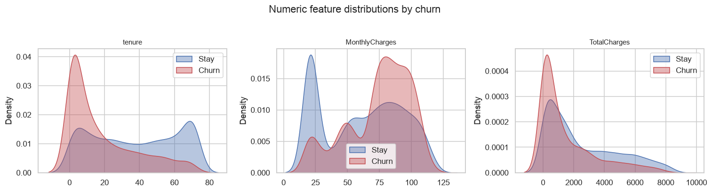
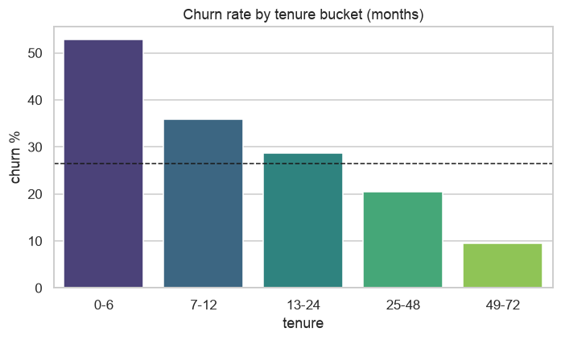
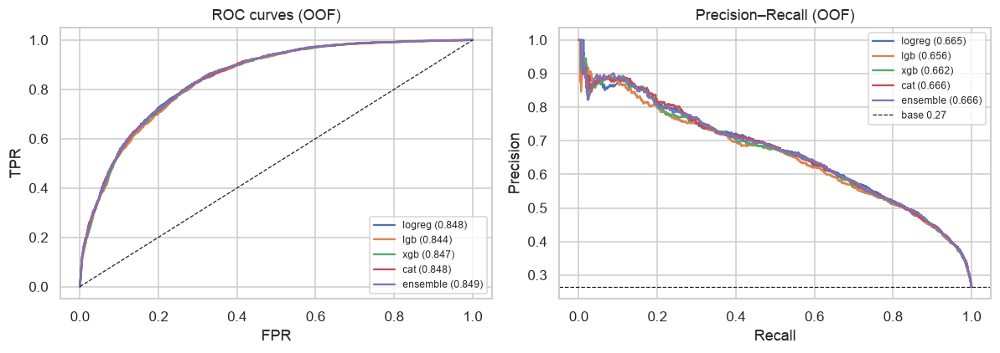
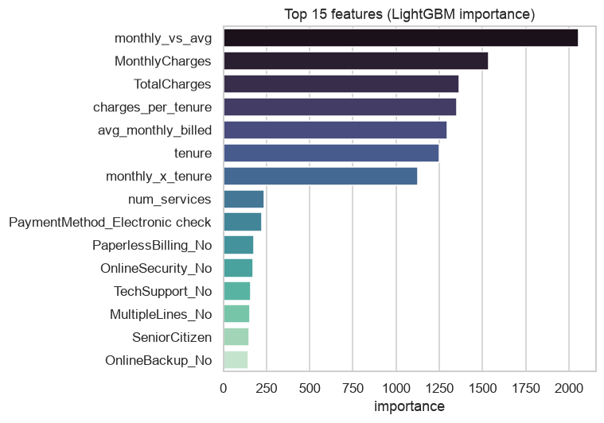

# Predicting Customer Churn from Account and Billing Attributes: A Benchmarking Study on the IBM Telco Dataset

**Abstract**

Customer churn — a subscriber discontinuing service — is a central concern for subscription businesses,
where retaining an existing customer is far cheaper than acquiring a new one. Using the widely studied IBM
Telco Customer Churn dataset (7,043 customers, 26.5% churn), we build an end-to-end pipeline to predict
churn from demographic, service, contract, and billing attributes, and we benchmark a linear baseline
against three gradient-boosting models under matched cross-validation. Framing the task around ROC-AUC and
PR-AUC (appropriate to the class imbalance), our soft-voting ensemble reaches ROC-AUC 0.849, but a
regularized logistic regression is statistically indistinguishable (0.848), indicating that the churn
signal in this dataset is largely linear and additive. The strongest predictors are engineered billing
features — a customer's current monthly charge relative to their historical average, and charges per month
of tenure — together with contract type and tenure. We document a data-quality pitfall (the `TotalCharges`
field ships as text with blank values for new customers), discuss why accuracy is the wrong metric under
imbalance, and outline the cost-sensitive thresholding a deployment would require.

**Keywords:** customer churn, imbalanced classification, gradient boosting, logistic regression, ROC-AUC,
feature engineering.

---

## 1. Introduction

Subscription businesses live and die by retention. Because acquiring a customer typically costs several
times more than retaining one, even modest improvements in identifying at-risk customers translate into
material savings when paired with a retention intervention. Churn prediction is therefore one of the most
common applied machine-learning tasks in telecommunications, streaming, SaaS, and financial services.

This paper studies the IBM "Telco Customer Churn" dataset, a standard public benchmark. Each row is a
customer described by demographics (gender, senior-citizen status, partner/dependents), subscribed services
(phone, internet, and add-ons such as online security and tech support), account terms (contract type,
paperless billing, payment method, tenure), and charges (monthly and total). The binary label indicates
whether the customer churned. Our contributions are: (1) a reproducible four-phase pipeline (analysis →
cleaning → feature engineering → modeling); (2) a controlled benchmark showing that a linear model matches
gradient boosting on this dataset; (3) an analysis of which engineered signals matter and why; and (4)
explicit treatment of the imbalance-aware evaluation and data-quality issues that this dataset is known for.

## 2. Related work

Churn modeling is dominated by tree ensembles and regularized linear models on tabular data. Gradient
boosting — XGBoost [Chen & Guestrin 2016], LightGBM [Ke et al. 2017], and CatBoost
[Prokhorenkova et al. 2018] — is the default for heterogeneous tabular features. Under class imbalance,
threshold-free metrics such as ROC-AUC and the area under the precision–recall curve are preferred to raw
accuracy, and class re-weighting or resampling is standard practice. The IBM Telco dataset in particular is
a common teaching and benchmarking example, and reported ROC-AUC for well-tuned models typically falls in
the 0.83–0.86 range, which frames our expectations.

## 3. Data and exploratory analysis

The dataset contains 7,043 customers and 21 columns. The target, `Churn`, is imbalanced at **26.5%**
positive (Figure 1), so we evaluate with ROC-AUC and PR-AUC rather than accuracy.

**Data quality.** The `TotalCharges` column is stored as text and contains 11 blank strings; every one of
these corresponds to a customer with `tenure == 0` — a brand-new customer who has not yet been billed. We
coerce the column to numeric and impute these with 0. Nine service columns encode "No internet service" or
"No phone service" as a distinct third category, which we retain as signal.

**Categorical drivers.** Association strength with churn (Cramér's V) is led by contract type (0.41),
followed by the absence of online security and tech support, internet-service type, and payment method
(Figure 2, Figure 3). Demographic fields are nearly irrelevant: `gender` (0.008) and `PhoneService`
(0.011). The churn rate for month-to-month contracts, fiber-optic internet, and electronic-check payment is
roughly 42–45%, versus a 26.5% base rate.

**Numeric drivers.** Churners are systematically newer and pay more per month but less in total (all
Mann–Whitney p ≪ 0.001): mean tenure 18 vs. 38 months, monthly charges \$74 vs. \$61, total charges \$1.5k
vs. \$2.6k. The tenure effect is steep — churn risk is highest in the first six months and falls sharply
after the first year (Figure 4, Figure 5).

## 4. Methodology

**Cleaning.** Coerce `TotalCharges` to numeric and impute tenure-0 blanks with 0; normalize string dtypes.

**Feature engineering.** Beyond one-hot encoding of the categoricals, we add: a count of subscribed add-on
services (`num_services`), `has_internet`, `streaming_count`, `is_month_to_month`, an automatic-payment
flag, and an `is_new_customer` flag; and billing-dynamics features `charges_per_tenure`,
`avg_monthly_billed`, `monthly_x_tenure`, and `monthly_vs_avg` (current monthly charge minus the customer's
historical average). This yields 55 numeric features.

**Modeling.** We frame churn as binary classification with probabilistic output. Base learners are a
standardized, class-balanced logistic regression and three gradient-boosting classifiers (LightGBM,
XGBoost, CatBoost) with per-model imbalance handling (`class_weight` / `scale_pos_weight` /
`auto_class_weights`). All models are evaluated with StratifiedKFold (K=5) repeated over three seeds
{42, 2024, 7}; we report out-of-fold ROC-AUC and PR-AUC, and the F1 at the F1-optimal probability
threshold. A soft-voting ensemble averages the four models' predicted probabilities.

## 5. Results

All four models cluster tightly, and the ensemble is best by a hair (Table 1, Figure 6). Crucially, the
regularized logistic regression (0.848) is statistically indistinguishable from the boosted models,
indicating a largely linear signal.

*Table 1. Out-of-fold performance (5-fold × 3 seeds).*

| model | ROC-AUC | PR-AUC | best-F1 |
|---|---|---|---|
| Logistic Regression | 0.848 | 0.665 | 0.637 |
| LightGBM | 0.844 | 0.656 | 0.629 |
| XGBoost | 0.847 | 0.662 | 0.631 |
| CatBoost | 0.848 | 0.666 | 0.633 |
| **Ensemble** | **0.849** | 0.666 | 0.635 |

The most important features (Figure 7) are the engineered billing-dynamics terms — `monthly_vs_avg`,
`charges_per_tenure`, `avg_monthly_billed` — alongside raw monthly/total charges and tenure. That a
customer's *current price relative to their own history* is the single strongest signal is intuitive: a
recent bill increase is a plausible churn trigger. Contract and service-absence indicators follow.

## 6. Discussion

Two findings stand out. First, **gradient boosting offers no meaningful advantage over logistic regression
here**: the relationship between features and churn is close to linear/additive once sensible billing
features are engineered. This is a useful reminder that model complexity should be justified by data, not
assumed. Second, **feature engineering, not model choice, moved the needle** — the billing-dynamics
features outrank every raw field, and they encode a behavioral hypothesis (price shocks drive churn) that a
raw snapshot does not.

For deployment, ROC-AUC is only a starting point. A retention team acts on a ranked list under a budget, so
precision and recall at an operating threshold — chosen from the economics of the retention offer versus
the margin of a saved customer — matter more than AUC. We report the F1-optimal threshold, but the correct
threshold is business-specific and cost-sensitive.

## 7. Limitations

- **Signal ceiling.** ROC-AUC ~0.85 is typical for this dataset; the label is a single snapshot with no
  longitudinal behavior (usage trends, support tickets, competitor pricing) that would sharpen prediction.
- **No temporal split.** A time-based validation would better reflect deployment, where the model scores
  future customers.
- **Static features.** The strongest signal (`monthly_vs_avg`) is a within-row proxy for a price change;
  true time-series billing history would likely be stronger still.

## 8. Conclusion

On the IBM Telco dataset, churn is predictable to ROC-AUC ≈ 0.85 from account and billing attributes, with
contract type, tenure, and engineered billing-dynamics features carrying the signal. A regularized linear
model matches gradient boosting, so the practical levers are feature engineering and imbalance-aware,
cost-sensitive evaluation rather than model complexity. The pipeline and experiments are fully reproducible
from the accompanying code.

## References

- Chen, T., & Guestrin, C. (2016). XGBoost: A scalable tree boosting system. *KDD*.
- Ke, G., et al. (2017). LightGBM: A highly efficient gradient boosting decision tree. *NeurIPS*.
- Prokhorenkova, L., et al. (2018). CatBoost: Unbiased boosting with categorical features. *NeurIPS*.
- Saito, T., & Rehmsmeier, M. (2015). The precision–recall plot is more informative than the ROC plot when
  evaluating binary classifiers on imbalanced datasets. *PLoS ONE*, 10(3), e0118432.

*Reproducibility: see `src/` and `reports/`. All metrics are 5-fold × 3-seed out-of-fold; seeds {42, 2024, 7}.*
