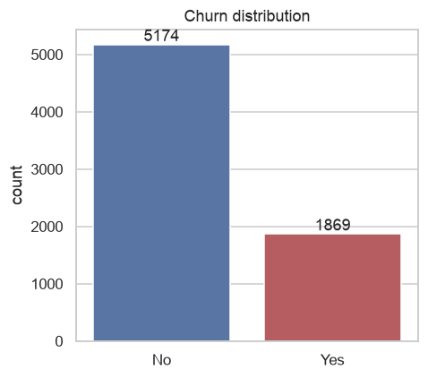
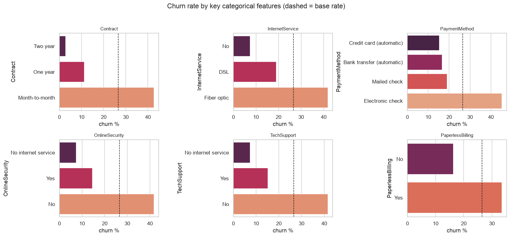
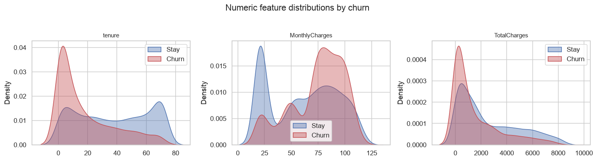
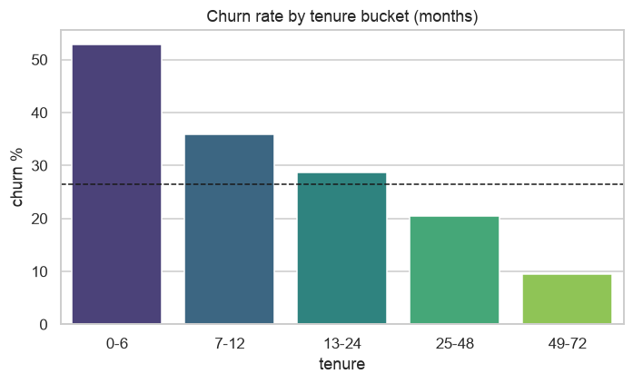
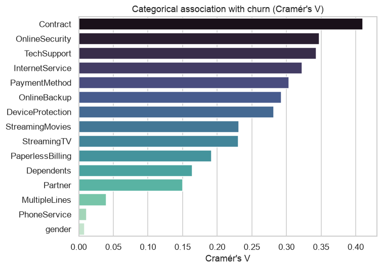

# Phase 1 — Data Analysis & Exploration

IBM Telco Customer Churn. Auto-generated by `src/eda.py`.

## 1a. Data overview

- shape: 7043 customers x 21 columns
- categorical features: 15 | numeric: 4
- ID column `customerID` (7043 unique) → dropped from features.

## 1b. Target: churn balance

- churn rate: 26.5% (Yes=1869, No=5174) — class imbalance.

## 1c. Data quality

- **`TotalCharges` had 11 blank strings** → coerced to NaN. All correspond to `tenure == 0`:
  tenure of blank-TotalCharges rows: [np.int64(0)] (brand-new customers, no bill yet). Impute 0 in cleaning.
- `SeniorCitizen` is already 0/1 encoded. Service columns use 'No internet service' / 'No phone service' as a distinct third level.

## 1d. Churn rate by categorical driver

Dashed line = overall base rate (26.5%). Month-to-month contracts, fiber-optic internet, electronic-check payment, and lack of online security / tech support show markedly higher churn.

## 1e. Numeric features vs churn

Churners concentrate at **low tenure** and **high monthly charges**; long-tenure customers rarely churn.

## 1f. Feature–target association

**Categorical features vs churn (Cramér's V):**

         feature  cramers_v
        Contract   0.410116
  OnlineSecurity   0.347400
     TechSupport   0.342916
 InternetService   0.322455
   PaymentMethod   0.303359
    OnlineBackup   0.292316
DeviceProtection   0.281580
 StreamingMovies   0.230951
     StreamingTV   0.230502
PaperlessBilling   0.191498
      Dependents   0.163870
         Partner   0.150126
   MultipleLines   0.040109
    PhoneService   0.011398
          gender   0.008291

**Numeric features (Mann–Whitney, churn vs stay means):**

       feature  mean_churn  mean_stay        p
        tenure        18.0       37.6 2.4e-208
MonthlyCharges        74.4       61.3  3.3e-54
  TotalCharges      1531.8     2555.3  2.0e-84

## 1g. Hypotheses & takeaways

1. Contract type is the dominant driver: month-to-month customers churn far more than 1/2-year contracts.
2. Short tenure → high churn; risk drops sharply after the first year (retention/onboarding effect).
3. Fiber-optic + electronic-check + paperless billing mark a high-churn segment (price-sensitive, less sticky).
4. Add-on services (OnlineSecurity, TechSupport) reduce churn → "stickiness" features.
5. High monthly charges raise churn, but high *total* charges (a proxy for tenure) lower it — engineer
   charges-per-tenure and a service-count feature.
6. Metric: churn is imbalanced (26.5%) → optimize/report ROC-AUC and PR-AUC, not raw accuracy.
